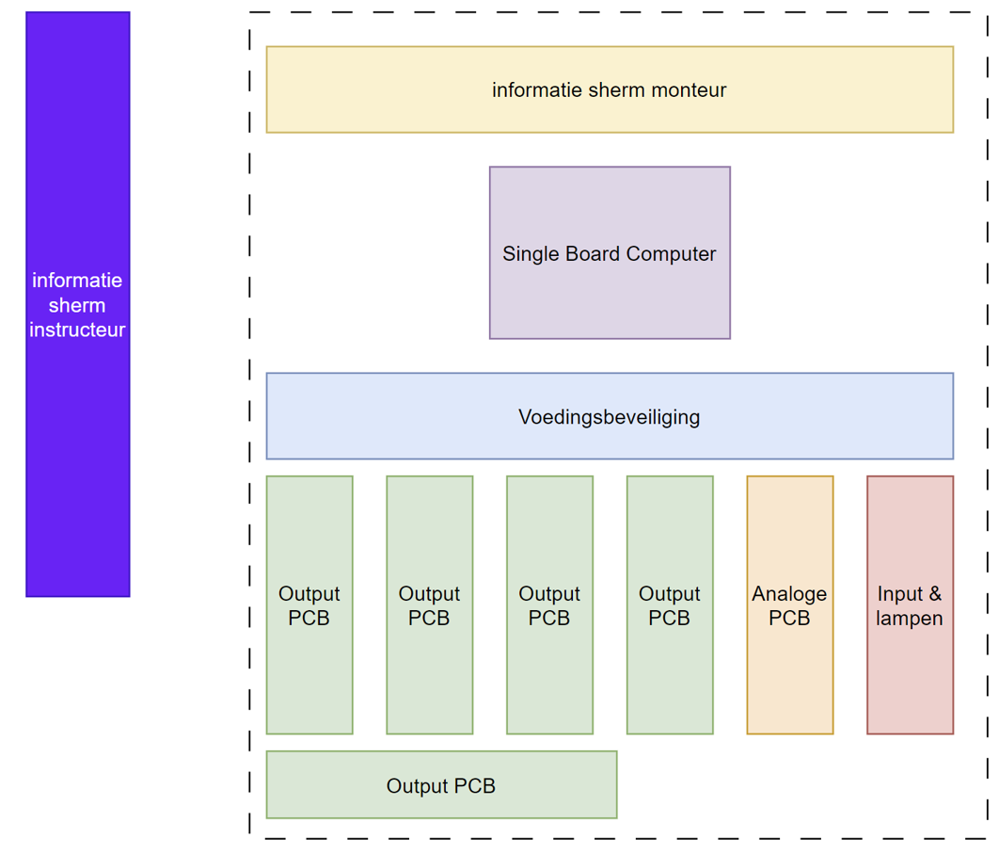
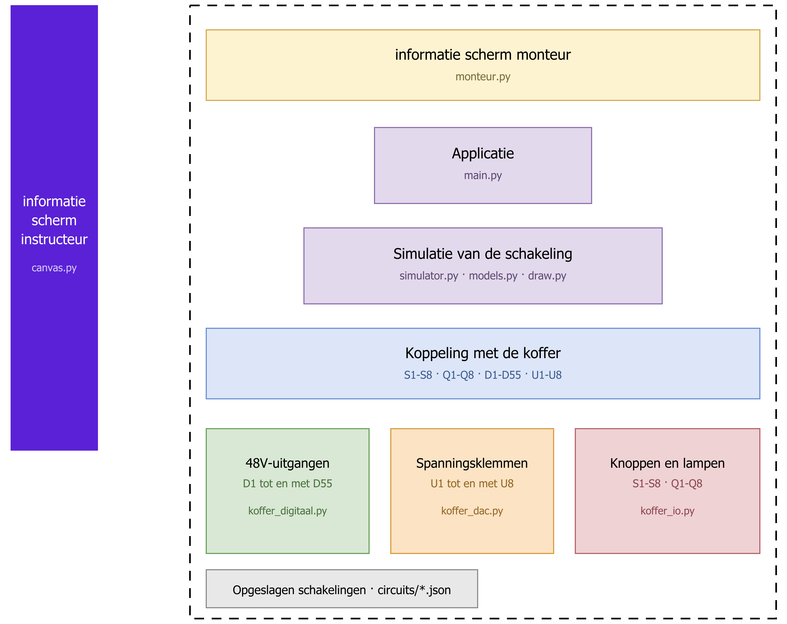

# ret-storingskoffer-2026

# Inleiding (Dutch)

Deze Github repository dient als handleiding en technische documentatie voor de software van de storingskoffer. De informatie die in deze repository te vinden is, is bedoeld voor het technische personeel van firma Rotterdam Elektrische Tram (RET).

De storingskoffer is een trainingsmiddel dat ontwikkeld is om deelschakelingen uit de gelijkrichterstations van de RET na te bootsen. Hiermee kunnen onderhouds- en storingsmonteurs in-house getraind worden in het opsporen en verhelpen van elektrotechnische storingen, zonder dat hiervoor een externe cursus bij het Railcenter nodig is.

De software in deze repository vormt deelsysteem 3 (centrale control unit), deelsysteem 4 (gebruikersinterface instructeur) en deelsysteem 5 (gebruikersinterface monteur) uit het architectuurontwerp.

De functionaliteiten van de software zijn:

- Het tekenen en bewerken van deelschakelingen op een rasteroppervlak.
- Het opslaan en laden van deelschakelingen als JSON-bestand.
- Het simuleren van de elektrische werking van een deelschakeling (stroomvoering, relaiswerking en schakelaarstanden).
- Het instellen van storingen per component, waarbij de storing tijdens het examen verborgen blijft voor de monteur.
- Het instellen van de examentijd die de monteur krijgt om de storing te zoeken.
- Het koppelen van componenten aan de GPIO-pinnen van de Raspberry Pi, zodat de fysieke schakelaars en lampen in de koffer meelopen met de simulatie.
- Het weergeven van de schakeling op twee gescheiden schermen: een bedieningsscherm voor de instructeur en een examenscherm voor de monteur.

# Intro (English)

This GitHub repository serves as a manual and technical documentation for the software of the fault simulation case. The information provided in this repository is intended for the technical staff of the Rotterdam Electric Tram (RET) company.

The fault simulation case is a training tool developed to reproduce sub-circuits from the rectifier stations of the RET. This allows maintenance and fault-finding technicians to be trained in-house in locating and resolving electrical faults, without requiring an external course at the Railcenter.

The functionalities of the software are:

- Drawing and editing sub-circuits on a grid surface.
- Saving and loading sub-circuits as a JSON file.
- Simulating the electrical behaviour of a sub-circuit (current flow, relay operation and switch positions).
- Configuring faults per component, where the fault remains hidden from the technician during the examination.
- Setting the examination time the technician is given to find the fault.
- Linking components to the GPIO pins of the Raspberry Pi, so that the physical switches and lamps in the case follow the simulation.
- Displaying the circuit on two separate screens: a control screen for the instructor and an examination screen for the technician.

The English translated documentation of this page can be found below the dutch documentation.

# De elektronica

De elektronica van de storingskoffer bestaat uit een Raspberry Pi 5, een Raspberry Pi Touch Display 2, een externe HDMI-monitor en een aantal door de RET ontwikkelde printplaten.

De twee schermen hebben elk een eigen taak:

| Scherm | Aansluiting | Gebruiker | Inhoud |
|-------------------------|-------------|-------------|--------------------------------------------------|
| Externe monitor | HDMI0 | Instructeur | Volledig dashboard: ontwerpen, storing, examen |
| Raspberry Pi Touch 2 | DSI | Monteur | Statische schakeling en examentijd |

## Schematische opzet van de hardware



De gestreepte lijn is de koffer zelf. Het informatiescherm van de instructeur staat erbuiten, want dat is een losse monitor die via HDMI wordt aangesloten. Binnen de koffer zit bovenin het scherm van de monteur, de Raspberry Pi Touch Display 2, en daaronder de Single Board Computer, een Raspberry Pi 5, die alles aanstuurt.

De voedingsbeveiliging verdeelt de voeding over de printen eronder. Alle printen hangen aan dezelfde SPI-bus van de Raspberry Pi en hebben elk een eigen hardware-adres:

| Blok in de tekening | Wat het doet | Aansluiting |
|------------------------|-------------------------------------------------------|----------------------|
| Output PCB (5×) | 48V-uitgangen naar de klemmen `D1` tot en met `D55` | CE0, adres `001` tot en met `101` |
| Analoge PCB | Spanningsklemmen `U1` tot en met `U8` en de stroomlussen | CE1 |
| Input & lampen | Knoppen `S1` tot en met `S8` en lampen `Q1` tot en met `Q8` | CE0, adres `000` |

In de tekening staat de analoge print als één blok; in de koffer zijn het twee DAC-printen, die samen de acht spanningsklemmen leveren.

De printplaten die op de Raspberry Pi worden aangesloten zijn:

- De voedingsbeveiliging (deelsysteem 2), die de 24 VDC van de hoofdvoeding omzet naar een 5 VDC- en een 48 VDC-busrail, en die de kortsluitbeveiliging en de noodstop bevat.
- De digitale outputmodule (deelsysteem 6), die de digitale signalen van de Raspberry Pi omzet naar schakelspanningen van 48 V. Omdat de nagebootste deelschakelingen tussen de 50 en 100 contacten bevatten en de Raspberry Pi zelf maar 28 bruikbare GPIO-pinnen heeft, wordt gebruikgemaakt van MCP23S17 I/O-expanders op de SPI-bus.

Er zijn vijf digitale outputmodules gebouwd, op hardware-adres `001` tot en met `101`. Van de zestien uitgangen per kaart werken er vijf niet: in de telling van de MCP23S17 zijn dat pin 6, 7, 12, 13 en 14, op de printopdruk 7, 8, 13, 14 en 15. Dat is op elke kaart dezelfde set, dus het ligt niet aan een losse print maar aan het ontwerp. Er blijven elf bruikbare uitgangen per kaart over, samen 55 in plaats van 80. Alleen die 55 zijn op de koffer doorverbonden en ze heten `D1` tot en met `D55`; de verdeling staat in `pcb_tests/digitaal/uitgangen.json`.

De volledige onderbouwing van de printplaten, inclusief de schematische tekeningen, de componentkeuzes en de berekeningen, is te vinden in het projectdocument.

# De software

De software die op de Raspberry Pi van de storingskoffer draait is als volgt opgebouwd. Voor het besturingssysteem wordt een Linux kernel gebruikt (Raspberry Pi OS). Hierin wordt een virtuele omgeving opgebouwd in Python. In deze virtuele omgeving VENV (Virtual Environment) wordt de Python app opgestart die de grafische interface beheert en de GPIO-pinnen aanstuurt.

## Schematische opzet van de software



De software volgt dezelfde indeling als de hardware, zodat de twee tekeningen naast elkaar te lezen zijn. Het informatiescherm van de instructeur is `canvas.py`, met daarin de editor, de storingen, het examen en de koppeling met de koffer. Het scherm van de monteur is `monteur.py`, dat alleen de tekening en de examentijd laat zien. `main.py` start de app en zet beide vensters op het juiste scherm.

Daaronder rekent `simulator.py` uit welke punten van de schakeling onder spanning staan en welke componenten werken, met `models.py` voor de gegevens van de componenten en `draw.py` voor de symbolen. De koppeling verdeelt de uitkomst over de kanalen van de koffer: de knoppen `S`, de lampen `Q`, de 48V-uitgangen `D` en de spanningsklemmen `U`.

Onderin staat per print een eigen aansturing, met dezelfde kleur als de print in de hardwaretekening: `koffer_digitaal.py` voor de uitgangskaarten, `koffer_dac.py` voor de analoge print en `koffer_io.py` voor de knoppen- en lampenprint. De schakelingen zelf worden als JSON-bestand opgeslagen in de map `circuits`.

De grafische interface is gebouwd met PyQt5. De schakelingen worden niet als afbeelding ingeladen maar in de app zelf getekend, zodat elke schakeling in de editor aangepast kan worden zonder de broncode te wijzigen.

## De opbouw van de repository

| Bestand | Functie |
|------------------|--------------------------------------------------------------------------|
| `main.py` | Opstartpunt. Maakt beide vensters aan en verdeelt ze over de schermen. |
| `canvas.py` | De tekenlaag (`CircuitCanvas`), de dialoogvensters en het instructeursvenster (`MainWindow`). |
| `monteur.py` | Het examenscherm voor de monteur (`MonteurCanvas` en `MonteurWindow`). |
| `display.py` | Bepaalt op welk scherm welk venster terechtkomt. |
| `koffer_io.py` | De aansturing van de knoppen- en lampenprint via SPI. |
| `koffer_dac.py` | De aansturing van de spanningsklemmen U1 tot en met U8 via de DAC-printen. |
| `koffer_digitaal.py` | De aansturing van de digitale 48V-uitgangen D1 tot en met D55. |
| `schermtest.py` | Diagnose: toont welke schermen Qt ziet en hoe ze verdeeld worden. |
| `simulator.py` | De elektrische simulatie van de schakeling. |
| `gpio_manager.py`| De koppeling tussen de simulatie en de GPIO-pinnen. |
| `models.py` | De dataklassen `Component` en `Wire` en de nummering van de contacten. |
| `draw.py` | De tekenroutines van de elektrotechnische symbolen. |
| `constants.py` | Alle constanten, kleuren en gereedschapsdefinities. |
| `circuits/` | De opgeslagen deelschakelingen als JSON-bestand. |
| `pcb_tests/` | Losse testscripts per printplaat, onafhankelijk van de app. |

## Het handmatig starten van de app

Voor het handmatig starten van de Python app met VENV (Virtual Environment) zijn de volgende commando's nodig. Deze commando's dienen ingevuld te worden in de terminal van Linux:

```console
cd ~/Github/ret-storingskoffer-2026
source venv-rpi/bin/activate  << start de VENV
python3 main.py               << start de App
```

Op Windows wordt de app op dezelfde manier gestart, maar met de commando's van PowerShell:

```console
.\env\Scripts\Activate.ps1
python main.py
```

## Het aanmaken van de virtuele omgeving

De virtuele omgeving is platformafhankelijk en moet daarom op elk apparaat opnieuw aangemaakt worden. Op de Raspberry Pi gebeurt dit met de volgende commando's:

```console
sudo apt update
sudo apt install python3-venv python3-pyqt5 python3-rpi.gpio
python3 -m venv venv-rpi --system-site-packages
source venv-rpi/bin/activate
```

PyQt5 wordt hier bewust via `apt` geïnstalleerd en niet via `pip`. Voor de ARM-processor van de Raspberry Pi zijn geen kant-en-klare PyQt5 pakketten beschikbaar op pip, waardoor pip het volledige Qt framework vanuit de broncode gaat compileren. Dit duurt meerdere uren en mislukt vaak alsnog. De optie `--system-site-packages` zorgt ervoor dat de virtuele omgeving bij de via apt geïnstalleerde pakketten kan.

Op Windows is dit niet nodig en volstaat het volgende:

```console
python -m venv env
.\env\Scripts\Activate.ps1
pip install -r requirements.txt
```

# De gebruikersinterface

## Het scherm van de instructeur

Het instructeursscherm heeft drie modi die linksboven omgeschakeld kunnen worden:

- **Bekijken** – hier kiest de instructeur een opgeslagen deelschakeling uit de lijst. De schakeling wordt weergegeven zonder dat er iets gewijzigd kan worden. Zodra er een schakeling gekozen is verschijnen de knoppen **Simuleren** en **Verwijderen**. Verwijderen wist het bestand van de schijf, na een bevestiging waarin de naam en het volledige pad staan. Tijdens een lopend examen wordt verwijderen geweigerd. Verwijder je de schakeling die op dat moment in beeld staat, dan blijft de tekening gewoon staan maar is er geen bestand meer om naar op te slaan; de statusbalk zegt dat je dan "Opslaan als" moet gebruiken.
- **Bewerken** – hier tekent de instructeur een nieuwe deelschakeling of past hij een bestaande aan. In deze modus kunnen ook de storingen en de koppeling met de hardware ingesteld worden.
- **Examen** – hier stelt de instructeur de examentijd in en start hij het examen.

Onderaan de zijbalk staan twee knoppen voor het beheer van de koffer.

**Software bijwerken** haalt met `git pull` de nieuwste versie van de software op en ververst daarna met `apt-get update` de pakketlijsten. Tijdens het uitvoeren blijft het venster reageren, en achteraf verschijnt een overzicht van wat er gebeurd is. Is er werkelijk nieuwe software opgehaald, dan meldt de app dat je de koffer opnieuw moet opstarten om die te gebruiken.

Voor het verversen van de pakketlijsten is root nodig. De app gebruikt daarom `sudo -n`, zodat er nooit op een wachtwoordprompt gewacht wordt. Mag de gebruiker dat niet, dan meldt de app dat; je lost het op met een regel in `/etc/sudoers.d/storingskoffer`, aan te maken met `sudo visudo -f /etc/sudoers.d/storingskoffer`:

```console
pi ALL=(ALL) NOPASSWD: /usr/bin/apt-get update
```

Op een computer die geen Raspberry Pi is wordt alleen de software opgehaald en worden de pakketlijsten overgeslagen.

De knop **Koffer uitschakelen**. Die vraagt of de koffer afgesloten of opnieuw opgestart moet worden. Voordat de opdracht wordt doorgegeven stopt de app een eventueel lopend examen, verlaat de simulatie en zet alle lampen en uitgangen uit. Dat is nodig omdat bij een directe afsluiting de normale afsluitroutine niet meer aan bod komt en de uitgangen anders in hun laatste stand blijven staan.

Op een computer die geen Raspberry Pi is gebeurt er niets; de app meldt dan alleen dat de opdracht uitsluitend op de koffer werkt. Zo sluit een misklik tijdens het ontwikkelen niet je eigen machine af.

Afsluiten gebeurt via `systemctl poweroff`. Krijg je de melding `Interactive authentication required`, dan mag de gebruiker dat niet zonder wachtwoord. Dat los je op met een polkit-regel in `/etc/polkit-1/rules.d/50-storingskoffer.rules`:

```console
polkit.addRule(function(action, subject) {
    if ((action.id == "org.freedesktop.login1.power-off" ||
         action.id == "org.freedesktop.login1.reboot") &&
        subject.user == "pi") {
        return polkit.Result.YES;
    }
});
```

In de Bewerken-modus zijn de volgende componenten beschikbaar:

| Gereedschap | Symbool | Aantal contacten |
|-----------------------------|---------|------------------|
| Draad | – | – |
| Net Label | – | 0 |
| Schakelaar (1P) | S | 2 |
| Schakelaar 2P NO | S | 4 |
| Schakelaar 2P NC | S | 4 |
| 2-weg wisselschakelaar | S | 3 |
| Relaisspoel | K | 2 |
| Relaiscontact | K | 2 |
| 2-weg relaiscontact | K | 3 |
| Motor | M | 2 |
| Lamp | H | 2 |
| Voeding (+V) | +V | 0 |
| GND | GND | 0 |

Componenten met hetzelfde label worden automatisch aan elkaar gekoppeld. Een relaiscontact met label `K1` volgt dus de relaisspoel met label `K1`. De automatische nummering loopt per labelgroep door: alle soorten schakelaars tellen samen op als `S1`, `S2`, `S3`, ongeacht of het een eenpolige, tweepolige of wisselschakelaar is. Relaisspoelen en relaiscontacten houden juist een eigen telling, zodat spoel `K1` en contact `K1` standaard bij elkaar horen. Een label dat je zelf instelt wordt niet meer hernummerd en houdt zijn nummer bezet. Net Labels met dezelfde naam worden in de simulatie als één knooppunt behandeld, zodat een schakeling over meerdere bladen verdeeld kan worden zonder dat er een draad tussen getekend hoeft te worden.

### Sneltoetsen en de knoppen boven de tekening

In de Bewerken-modus staan de sneltoetsen onderaan de zijbalk. Ze werken op het geselecteerde symbool:

| Toets | Werking |
|-------|------------------------------------------|
| R | Roteren in stappen van 90 graden |
| N | Naam wijzigen; het label wordt dan niet meer automatisch hernummerd |
| C | Contactnummers instellen |
| F | Storing aan of uit |
| Del of Backspace | Verwijderen |
| Esc | Selectie of een begonnen draad annuleren |

Verplaatsen gaat door te slepen, verwijderen kan ook met de rechtermuisknop, en een draad trek je door op het beginpunt en daarna op het eindpunt te klikken.

In de storingen- en de koppellijst staan de componenten per soort gegroepeerd en op nummer gesorteerd: eerst de voedingen, dan alle schakelaars (S1, S2, S10), dan elke relaisspoel met haar contacten eronder, dan de lampen, motoren en net labels.

Boven de tekening staan in de Bewerken-modus en tijdens de simulatie drie knoppen. **Storingen** stelt per symbool de soort storing in. **Hardware koppeling** hangt een symbool aan een kanaal van de koffer. **Koppelingen** laat zien welk relaiscontact bij welke spoel hoort en laat een contact aan een andere spoel hangen; zie het volgende hoofdstuk.

Schakelaars en relaiscontacten zijn aan hun kleur uit elkaar te houden: alles wat met de hand bediend wordt is groen, alles wat door een spoel bediend wordt is paars. Dat geldt ook voor de twee 2-weg varianten, die verder hetzelfde symbool hebben.

## Het scherm van de monteur

Het monteursscherm toont uitsluitend de schakeling die de instructeur heeft klaargezet, plus de resterende examentijd. Er is bewust geen menu, geen weergave van de stroomvoering en geen markering van de storing: de monteur ziet een statische tekening, zoals hij die in de praktijk ook op papier zou krijgen.

Het scherm kent drie toestanden:

- **Wachten op de instructeur** – er is nog geen examen gestart.
- **Examen** – de schakeling en de aftellende examentijd zijn zichtbaar.
- **Einde examen** – de tijd is verstreken of de instructeur heeft het examen gestopt.

Op het moment dat de instructeur op "Start Examen" drukt, wordt een kopie van de schakeling naar het monteursscherm gestuurd. In die kopie wordt de storingsmarkering gewist, zodat de storing niet in het geheugen van het monteursvenster terechtkomt. Wanneer de examentijd verstreken is, verschijnt op het instructeursscherm een overzicht van de ingestelde storingen en op het monteursscherm alleen de melding "Einde examen".

# De simulatie

De simulator werkt met een vereenvoudigd aan/uit-model. Vanuit elk voedingscomponent (+V) en elk GND-component wordt met een breadth-first search bepaald welke knooppunten onder spanning staan en welke aan GND liggen. Een component is actief wanneer de ene aansluiting onder spanning staat en de andere aan GND ligt.

Omdat een relaisspoel een relaiscontact kan bekrachtigen dat op zijn beurt weer een andere spoel voedt, wordt deze berekening herhaald tot de toestand stabiel is, met een maximum van twintig stappen.

## De beschikbare storingen

Per component kan de instructeur een storing instellen, en per component is er een keuze uit de soorten storing die daarbij passen. Dat gebeurt in de storingendialoog: een vinkje zet de storing aan, de keuzelijst ernaast bepaalt wat er misgaat, en de kolom ernaast beschrijft het gevolg.

**Vast.** De klassieke storing: het component doet het niet meer. Dit is het gedrag dat er altijd al was en het blijft de standaard.

| Component | Gedrag bij een vaste storing |
|--------------------------|-----------------------------------------------|
| Schakelaar (1P en 2P) | Sluit nooit, blijft altijd open |
| 2-weg wisselschakelaar | Blijft vast staan op positie B |
| Relaisspoel | De koppeling tussen spoel en contact is verbroken |
| Relaiscontact | Het contact sluit nooit |
| 2-weg relaiscontact | De koppeling is verbroken, blijft vast op B |
| Motor | Draait niet, ook al staat er spanning op |
| Lamp | Gaat niet branden, ook al staat er spanning op |

**Klappert.** Het component wisselt elke 400 ms tussen werkend en defect. Een relaisspoel die klappert laat zijn contacten steeds los, zoals een relais met een te lage spoelspanning of een vervuild contact. Dat werkt door in de hele schakeling: alles achter die contacten gaat mee knipperen, inclusief een uitgang die eraan gekoppeld is. Een klapperende spoel K1 laat dus klem D1 knipperen zonder dat er iets met D1 zelf aan de hand is, en dat is precies het soort storing waarvan de oorzaak niet staat waar het verschijnsel zichtbaar is. Bij een wisselschakelaar of een 2-weg relaiscontact laat het contact in de losse fase helemaal los en verbindt het geen van beide standen. Dat is bewust anders dan de vaste storing, die het contact op B laat staan: in rust staat zo'n contact toch al op B, en dan zou een klapper onzichtbaar zijn. In de tekening is dat te zien: de tong van het wisselcontact staat in de losse fase recht tussen A en B in, en een gewone schakelaar of een relaiscontact staat dan open.

De halve periode staat in `constants.py` als `KLAPPER_MS`. Zolang er een klapperstoring actief is, blijft de simulatie elke 50 ms doorrekenen, ook als er verder niets verandert.

**Geen spanning.** Alleen voor een component dat aan een klem gekoppeld is. De schakeling werkt gewoon, maar er komt niets uit de klem: een meetpunt geeft 0 V in plaats van zijn waarde, een 48V-uitgang blijft uit terwijl de simulatie hem aanstuurt. Dit bootst een onderbroken draad tussen de schakeling en de klem na.

**Afwijkende spanning.** Alleen voor een meetpunt. De klem geeft de ingestelde storingswaarde in plaats van de normale waarde. Door die waarde onder of boven de normale te zetten maak je een te lage of een te hoge spanning: 9 V waar 24 V hoort te staan wijst op een overgangsweerstand, 31 V waar 24 V hoort te staan op een verkeerd aangesloten voeding. Die waarde stel je in bij de koppeling, in de kolom "Bij storing".

**Storing op een relaiscontact.** Contacten met hetzelfde label horen bij hetzelfde relais. Geef je een van die contacten een storing, dan nemen de andere contacten van dat relais hem over, zowel in de storingendialoog als met de F-toets. Een klapperstoring op één contact van 641K7 laat dus alle contacten van 641K7 klapperen. Wil je juist één los contact defect hebben, haal dan in de storingendialoog het vinkje **Volgt relais** bij dat contact weg; zet je het weer aan, dan neemt het de storing van de rest van het relais over. Een storing op de spoel zelf werkt altijd door op alle contacten, want die volgen de spoel.

Welke soorten beschikbaar zijn hangt af van het component. Een schakelaar of relais kan vast of klapperend zijn; een component met een 48V-uitgang kan geen spanning geven of klapperen; een meetpunt kan een afwijkende waarde geven, geen spanning geven of klapperen.

Een storing in de meting of in de uitgang raakt de schakeling zelf niet. Het component werkt elektrisch gewoon door en alleen wat eruit komt klopt niet. Een vaste of klapperende storing werkt wel door in de schakeling, want daar is het component zelf stuk.

# De koppelingen tussen spoel en contact

Een relaiscontact volgt de spoel met hetzelfde label: contact K2 schakelt zodra spoel K2 bekrachtigd is. Dat label is dus de koppeling, en er is verder geen verborgen verwijzing. De knop **Koppelingen** boven de tekening toont per spoel welke contacten haar volgen, welke contacten geen spoel hebben, en welk kanaal van de koffer eraan hangt.

In dezelfde dialoog kies je per contact de spoel waar het bij hoort. Het contact krijgt dan het label van die spoel en wordt als handmatig gelabeld gemarkeerd, zodat het automatisch hernummeren het niet weer losmaakt. Een contact zonder spoel reageert in de simulatie nergens op, tenzij het aan een knop van de koffer gekoppeld is.

# De koppeling met de koffer

Een component kan aan een kanaal van de koffer gekoppeld worden. Dat gebeurt met de knop "Hardware koppeling" in de titelbalk, die zowel in de Bewerken-modus als tijdens de simulatie beschikbaar is. Het componenttype bepaalt welke kanalen er aangeboden worden:

| Component | Kanaal | Werking |
|------------------------------------------|----------|-----------------------------------------|
| Schakelaar, 2-weg wisselschakelaar, relaiscontact, 2-weg relaiscontact | S1 .. S8 | De fysieke knop stuurt de simulatie aan |
| Lamp, motor, relaisspoel | Q1 .. Q8 | De simulatie stuurt de fysieke lamp aan |
| Lamp, motor, relaisspoel | D1 .. D55 | De simulatie schakelt 48 V op een klem |
| Elk component, ook een net label | U1 .. U8 | De simulatie zet een spanning op de meetklem |

Elk kanaal hoort bij één component; de dialoog weigert te sluiten zolang twee componenten hetzelfde kanaal delen.

Een relaiscontact dat aan een knop gekoppeld is, volgt die knop en niet meer zijn spoel. Dat is bedoeld voor een deelschakeling waarin de spoel niet getekend is: de monteur bedient het contact dan rechtstreeks met de knop op de koffer. Zonder koppeling blijft het contact gewoon de spoel met hetzelfde label volgen.

De lampen zijn aangeduid met Q, gelijk aan de opdruk Q1 tot en met Q8 op de knoppen- en lampenprint. Een lamp in de tekening krijgt daarom ook het label Q1, Q2 en zo verder, zodat de tekening, de print en de koppeling dezelfde aanduiding gebruiken. In een eerdere versie heette een lamp H; die labels en kanalen blijven werken en worden bij het laden van de tekening automatisch omgenummerd naar Q.

De koppeling hoort bij de tekening en wordt daarom in het schakelingbestand bewaard. Zodra je het venster met OK sluit, wordt die koppeling meteen weggeschreven naar het bestand waar de schakeling uit komt. Je hoeft dus niet apart op te slaan, en na het opnieuw laden staat de koppeling er nog. De statusbalk meldt hoeveel kanalen er gekoppeld zijn en in welk bestand dat is vastgelegd.

Heeft de schakeling nog geen bestand, bijvoorbeeld na "Nieuw", dan kan er niets vastgelegd worden. De statusbalk zegt dat dan, zodat je weet dat je eerst "Opslaan als" moet gebruiken.

De print zit op de SPI-bus (CE0) op hardware-adres `000`. De lampen Q1 tot en met Q8 hangen aan GPB0 tot en met GPB7 en zijn niet geïnverteerd: een hoge bit laat de lamp branden. De knoppen S1 tot en met S8 hangen aan GPA0 tot en met GPA7 en zijn actief laag, met een externe pull-up op de print.

De aansturing zit in `koffer_io.py` en doet bewust **geen** hardware-reset: de RESET-lijn is gedeeld met de digitale 48V-kaarten en zou hun uitgangen laten zweven. Bij het starten van de simulatie wordt de print ingesteld met de latch eerst laag en pas daarna de richting op uitgang, zodat er geen lamp kort aanflitst. Bij het stoppen gaan alle lampen uit.

Tijdens de simulatie worden de knoppen elke 50 ms uitgelezen. Draait de app op een computer zonder `spidev`, dan wordt automatisch een mockversie van de print geladen. De volledige app blijft dan werken en de knoppen kunnen met de muis omgeschakeld worden via het monitorpaneel onderin het scherm. Hierdoor kan de software volledig op een laptop ontwikkeld en getest worden.

# De digitale uitgangen D1 tot en met D55

Een component kan ook aan een digitale 48V-uitgang gekoppeld worden. Die uitgangen zitten op de MCP23S17-kaarten van deelsysteem 6 en schakelen een echte 48 V op een klem van de koffer, zodat de simulatie een contactor, een signaallamp of een andere last in een oefenpaneel kan aansturen.

De koppeling werkt hetzelfde als bij de lampen: zodra het component in de simulatie stroom voert, gaat de uitgang aan. Het verschil is alleen waar het signaal naartoe gaat.

## De nummering

De klemmen heten `D1` tot en met `D55` en zijn doorlopend genummerd over de vijf kaarten heen. Op de koffer zijn alleen de werkende uitgangen doorverbonden, dus de defecte pinnen worden in die telling overgeslagen. De eerste kaart levert `D1` tot en met `D11`, de tweede `D12` tot en met `D22`, en zo verder.

| Klem | Kaart | MCP-pin |
|------|-------|---------|
| D1 | 001 | 0 |
| D6 | 001 | 5 |
| D7 | 001 | 8 |
| D11 | 001 | 15 |
| D12 | 010 | 0 |
| D55 | 101 | 15 |

De verdeling staat in `pcb_tests/digitaal/uitgangen.json` en wordt door `koffer_digitaal.py` ingelezen. Dat bestand is de enige plek waar de kaartvolgorde en de defecte pinnen vastliggen; `digital.py` uit de testmap leest hetzelfde bestand, zodat de klemnummers in de app en in de losse test altijd gelijk zijn. Komt er een kaart bij of wordt er een vervangen, dan is dat bestand het enige dat aangepast hoeft te worden.

> **Let op:** de volgorde onder `kaarten` bepaalt de nummering. Wissel die niet om zonder de koffer opnieuw te labelen, want dan verschuiven alle klemnummers.

## De aansturing

De aansturing zit in `koffer_digitaal.py`. De kaarten zitten op CE0, dezelfde bus als de knoppen- en lampenprint, maar op hardware-adres `001` en hoger; adres `000` wordt nooit aangeraakt. Net als `koffer_io.py` wordt de RESET-lijn alleen hoog gezet en niet gepulst, omdat die lijn gedeeld is.

Een latch van 1 geeft 48 V op de klem. Dat is aan de gebouwde kaarten gemeten; de uitgangstrap is dus niet inverterend. Bij het starten van de simulatie gaat de latch eerst op uit en pas daarna de richting op uitgang, zodat er geen uitgang kort aanslaat.

Er wordt alleen geschreven als er iets verandert, en bij het stoppen van de simulatie, het afsluiten van de app en het uitschakelen van de koffer gaan alle uitgangen uit.

Antwoordt een kaart niet, dan meldt de app dat en blijven de klemmen van die kaart dood; de overige kaarten werken gewoon door. Draait de app zonder `spidev`, dan wordt een mockversie geladen en is de koppeling op een laptop te testen zonder hardware.

# De meetpunten U1 tot en met U8

Een meetpunt is een plek in de tekening waarvan de spanning op een klem van de koffer komt te staan. De monteur meet daar met een multimeter, net als aan een echte installatie. De acht klemmen worden gevoed door de spannings-DAC's van de twee DAC-printen: U1 tot en met U4 door print 1 en U5 tot en met U8 door print 2.

Bijna elk component kan een meetpunt zijn, ook een net label of een voeding. GND valt er buiten, want daar staat altijd 0 V. Gemeten wordt er altijd op het **eerste aansluitpunt** van het component. In de tekening staat dat punt met een blauwe stip aangegeven, zodat er geen twijfel over kan bestaan waar de meting vandaan komt. Het klemnummer staat onder het symbool, bij een staand symbool rechts eronder.

## Hoe de spanning bepaald wordt

De simulatie rekent geen spanningen uit. Ze houdt bij welke punten met de voeding verbonden zijn en welke met GND, meer niet. De waarde die op de klem komt te staan wordt daarom per meetpunt ingesteld; de simulatie kiest alleen welke van die waarden het wordt:

| Toestand van het meetpunt | Spanning op de klem |
|------------------------------------------|---------------------------|
| Geen verbinding met de voeding | 0 V |
| Wel verbinding met de voeding | de ingestelde waarde, standaard 24 V |
| Wel verbinding, maar aangemerkt als storing | de storingswaarde, standaard 12 V |

Of er spanning op een punt staat is iets anders dan of er stroom door een component loopt. Een meetpunt vóór een open schakelaar leest nog gewoon spanning, terwijl er niets werkt. Dat is precies de situatie die een monteur bij het zoeken naar een storing tegenkomt: 24 V aan de ene kant van de schakelaar, 0 V aan de andere, en daaraan is te zien dat de schakelaar niet sluit.

De storingswaarde maakt een derde soort fout mogelijk die met lampen en knoppen niet te maken is: er staat wel spanning, maar te weinig. Een overgangsweerstand of een aangetaste draad gedraagt zich zo. Die waarde blijft ook tijdens het examen staan, anders zou de storing niet te meten zijn.

## Op het scherm

Op het instructeursscherm staat bij elk meetpunt het klemnummer met de actuele spanning, bijvoorbeeld `U1 24.0V`, en onderin verschijnt per klem een kaartje in het monitorpaneel. Op het monteursscherm staat alleen het klemnummer. De monteur ziet dus wel waar hij moet meten, maar niet wat eruit komt; dat moet hij zelf vaststellen.

## De aansturing

De aansturing zit in `koffer_dac.py`. De spanningsklemmen hangen aan de DAC8564's op CE1 in SPI-mode 1: U1 tot en met U4 aan adres `01` op print 1, U5 tot en met U8 aan adres `10` op print 2. De gevraagde spanning wordt door 19,2 gedeeld, want dat is de versterking van de MCP6002-booster, en daarna begrensd op 2,5 V aan de DAC en 48 V aan de klem.

Er wordt alleen geschreven als een waarde verandert. Bij het stoppen van de simulatie, bij het afsluiten van de app en bij het uitschakelen van de koffer gaan alle acht klemmen naar 0 V.

> **Let op:** de DAC8564 heeft geen data-uitgang, dus er is geen manier om te controleren of de DAC-print aangesloten is. Waar de knoppen- en lampenprint zich met een testpatroon laat herkennen, kan dat hier niet. Zit de print los, dan gebeurt er stil niets en komt dat pas bij het meten aan het licht.

De stroomlussen van 4 tot 20 mA worden nog niet door de app aangestuurd. Die zijn voorlopig alleen met `pcb_tests/analoog/koffer-analoog.py` te bedienen.

> **Let op:** de oude koppeling aan losse BCM-pinnen via `gpio_manager.py` bestaat nog voor bestanden van vóór deze wijziging, maar de dialoog biedt die niet meer aan. Zodra je een schakeling via de dialoog opnieuw koppelt, vervalt de pinkoppeling.

# De schermverdeling

Bij het opstarten bepaalt `display.py` zelf hoeveel schermen er aangesloten zijn:

- **Twee of meer schermen** – het monteursvenster wordt op het DSI-scherm gezet en het instructeursvenster op het HDMI-scherm. Beide vensters gaan schermvullend.
- **Eén scherm** – beide vensters worden naast elkaar op hetzelfde scherm gezet. Het monteursvenster krijgt hierbij exact 1280 x 720 pixels, de afmeting van de Raspberry Pi Touch Display 2, zodat tijdens het ontwikkelen op een laptop meteen zichtbaar is of de schakeling op het uiteindelijke scherm past.

Onder Wayland worden de schermen niet altijd met hun echte naam doorgegeven. In plaats van `DSI-1` en `HDMI-A-1` kunnen zij ook als `XWAYLAND0` en `XWAYLAND1` verschijnen, waarbij de volgorde per keer kan wisselen. Wanneer de automatische herkenning de vensters verkeerd verdeelt, kan de verdeling met de volgende omgevingsvariabelen afgedwongen worden:

```console
STORINGSKOFFER_LAYOUT=dev        << beide vensters op één scherm
STORINGSKOFFER_LAYOUT=pi         << verdeel over twee schermen
STORINGSKOFFER_MONTEUR=DSI-1     << schermnaam of index voor de monteur
STORINGSKOFFER_INSTRUCTEUR=0     << schermnaam of index voor de instructeur
```

## Wat de monteur ziet

Het monteursscherm toont de schakeling als een tekening op papier: geen menu, geen oplichtende draden en geen storingsmarkering. Wat er wél bij staat, is de koppeling met de koffer. Bij elk gekoppeld component staat het kanaalnummer, `S1` tot en met `S8` voor de knoppen, `Q1` tot en met `Q8` voor de lampen en `U1` tot en met `U8` voor de meetklemmen. Zonder die aanduiding is niet te zien welke van de acht knoppen of lampen bij welk symbool hoort.

De tekening wordt passend geschaald, en bij een grote schakeling wordt dat een flinke verkleining. Op een scherm van zeven inch zijn de componentnamen dan niet meer te lezen. Daarom worden alleen de namen tegen die verkleining in vergroot, zodat ze er altijd even groot uit komen; de contactnummers en de aanduidingen bij de aansluitpunten schalen gewoon mee met de tekening. De factor staat in `monteur.py` als `NAAM_VERGROTING` en de omrekening zit in `draw.py` in `stel_labelschaal`.

Met de toets `F11` kan in beide vensters de schermvullende weergave in- en uitgeschakeld worden. Met `Escape` verlaat het monteursvenster de schermvullende weergave. Dit is nodig omdat de vensters op de Raspberry Pi zonder titelbalk draaien.

# Het opslaan van een deelschakeling

Een deelschakeling wordt opgeslagen als JSON-bestand in de map `circuits`. Het bestand heeft de volgende opbouw:

```json
{
  "components": [
    {
      "type": "lamp",
      "col": 5,
      "row": 12,
      "label": "Q1",
      "rotation": 0,
      "contact_start": 1,
      "manual_contact_start": false,
      "gpio_pin": -1,
      "gpio_dir": "OUT",
      "defect": false,
      "manual_label": false,
      "kanaal": "Q1",
      "spanning_aan": 24.0,
      "spanning_storing": 12.0
    }
  ],
  "wires": [
    { "c1": 5, "r1": 10, "c2": 5, "r2": 12 }
  ],
  "exam_time_minutes": 10,
  "naam": "plusverdeler"
}
```

De velden `col` en `row` zijn rastercoördinaten, geen pixels. De contactnummering (`contact_start`) wordt bij het laden automatisch opnieuw berekend, tenzij het nummer handmatig is vastgezet met `manual_contact_start`.

Om een nieuwe deelschakeling aan de koffer toe te voegen hoeft er dus geen code aangepast te worden. De schakeling wordt in de Bewerken-modus getekend en in de map `circuits` weggeschreven, waarna hij direct in de lijst van de Bekijken-modus verschijnt.

Er zijn twee knoppen om op te slaan:

- **Opslaan** schrijft naar het bestand waar de schakeling uit komt, zonder iets te vragen. De statusbalk meldt in welk bestand het terecht is gekomen.
- **Opslaan als** vraagt om een naam en een bestand. Dit is de enige route voor een schakeling die nog nergens staat, en de manier om een bestaande schakeling onder een nieuwe naam af te splitsen.

Na "Opslaan als" en na het laden van een bestand is dat bestand het huidige, zodat "Opslaan" daarna meteen de juiste plek raakt. Na "Nieuw" is er geen huidig bestand en gedraagt "Opslaan" zich als "Opslaan als".

> De koppeling aan de kanalen van de koffer hoort bij de tekening en wordt meteen in het bestand vastgelegd zodra je het koppelvenster met OK sluit. Opslaan is daarvoor niet nodig.

# Software buggs

Er staan nog een aantal aandachtspunten (softwarefouten die niet destructief zijn voor de werking van de gehele module) in de Python code van de storingskoffer.

De aandachtspunten zijn:

| Bug | Impact | Status |
|---------------------------------------------------------|-------------------------------|--------|
| Een defecte motor of lamp onderbrak het circuit niet | Simulatie week af van de praktijk | Closed |
| Relaislabels wisselden om bij toevoegen of verwijderen | Schakeling gedroeg zich anders dan getekend | Closed |
| De Bekijken-modus liet het canvas bewerkbaar | Schakeling kon ongemerkt wijzigen | Closed |
| Twee componenten konden dezelfde GPIO-pin krijgen | Pin kreeg twee richtingen tegelijk | Closed |
| Klikken en verwijderen kozen een ander component | Verkeerd symbool verdween | Closed |
| Beide vensters startten op hetzelfde scherm | Tweeschermopstelling werkte niet | Closed |
| De MCP23S17 I/O-expanders worden nog niet aangestuurd | Aantal uitgangen beperkt tot 26 | Open |
| De virtuele omgeving en `__pycache__` staan in de repository | Repository onnodig groot | Open |
| Het instructeursvenster heeft een minimum van 1400 x 800 | Past niet op kleine schermen | Open |
| Er zijn vier van de tien deelschakelingen opgenomen | Voldoet nog niet aan F-REQ-1.0 | Open |

Twee van de gesloten punten verdienen een toelichting, omdat zij de uitkomst van een examen raakten.

Een defecte lamp of motor bleef in het simulatiemodel stroom geleiden. De component werd wel als inactief getekend en de GPIO-uitgang bleef laag, maar een monteur die de schakeling doormat vond achter een doorgebrande lamp nog steeds spanning. Een defect onderbreekt het circuit nu wel.

Relaislabels werden bij elke toevoeging of verwijdering opnieuw genummerd op volgorde in de lijst. Omdat de koppeling tussen spoel en contact uitsluitend op label werkt, konden twee relaiscontacten daardoor stilzwijgend van spoel wisselen. Labels die de instructeur zelf instelt worden nu vastgelegd met de vlag `manual_label` en niet meer automatisch hernummerd.

# Automatisch starten op de Raspberry Pi

Om de storingskoffer na het inschakelen vanzelf te laten opstarten, staan er twee
bestanden in de repository: `start_app.sh` en `storingskoffer.service`.

`start_app.sh` wacht tot de grafische sessie beschikbaar is, activeert de virtuele
omgeving en start de app. Dat wachten is nodig: zonder scherm valt `main.py` terug
op het offscreen-platform en verschijnt er nooit iets, zonder foutmelding.

```console
#!/bin/bash
cd "$(dirname "$0")" || exit 1

for _ in $(seq 1 30); do
    [ -e /tmp/.X11-unix/X0 ] && break
    sleep 1
done

source venv-rpi/bin/activate
exec python3 -u main.py
```
> start_app.sh

De service is een gebruikersservice, geen systeemservice. Dat is bewust: de app
heeft de grafische sessie van de gebruiker nodig, en een gebruikersservice start
mee met die sessie. De `%h` laat systemd zelf de thuismap invullen, zodat er geen
pad hardgecodeerd staat.

```console
[Unit]
Description=Storingskoffer Dashboard
After=default.target

[Service]
Type=simple
WorkingDirectory=%h/Github/ret-storingskoffer-2026
ExecStart=/bin/bash %h/Github/ret-storingskoffer-2026/start_app.sh
Environment=DISPLAY=:0
Environment=QT_QPA_PLATFORM=xcb
Restart=always
RestartSec=5

[Install]
WantedBy=default.target
```
> storingskoffer.service

## Installeren

```console
mkdir -p ~/.config/systemd/user
cp storingskoffer.service ~/.config/systemd/user/
systemctl --user daemon-reload
systemctl --user enable --now storingskoffer.service
```

De regel `Environment=QT_QPA_PLATFORM=xcb` is belangrijk. De Raspberry Pi draait
Wayland, maar de app positioneert zijn eigen vensters en heeft daarvoor XWayland
nodig. Zonder deze regel kan de verdeling over de twee schermen mislukken.

## Beheren

```console
systemctl --user status storingskoffer.service     # draait hij?
journalctl --user -u storingskoffer.service -f     # meldingen live meelezen
systemctl --user restart storingskoffer.service    # opnieuw starten
systemctl --user stop storingskoffer.service       # tijdelijk stoppen
systemctl --user disable --now storingskoffer.service
```

In het journaal zie je de opstartmeldingen terug, zoals `[KOFFER] print 000 klaar`
en `[SCHERM] Instructeur op HDMI-A-1, monteur op DSI-1`. Dat is de eerste plek om
te kijken als er iets niet goed gaat.

> **Let op tijdens het ontwikkelen:** door `Restart=always` start de app vanzelf
> opnieuw zodra je hem afsluit. Zet de service stil met `systemctl --user stop`
> voordat je handmatig gaat testen.

# De projectbestanden

Deze repository bevat alleen de software. Alle overige projectbestanden staan op de SharePoint-pagina van de afdeling Infraservices Energievoorziening, in de map [Said Keteldijk - Afstudeerproject - storingskoffer](https://retnv.sharepoint.com/teams/001069/Gedeelde%20%20documenten/Forms/AllItems.aspx?id=%2Fteams%2F001069%2FGedeelde%20%20documenten%2Fstagiaire%2FSaid%20Keteldijk%20%2D%20Afstudeerproject%20%2D%20storingskoffer). Daar is onder meer te vinden:

- `4-20mA PCB Autodesk Fusion 360 project` – het ontwerp van de stroomlusprint
- `48V output printplaat Autodesk Fusion 360` – het ontwerp van de digitale uitgangskaart
- `Behuizing` – het ontwerp van de koffer zelf
- `Extra COM printplaat` – het ontwerp van de extra communicatieprint
- `Github repository (codering voor de hardware)` – een kopie van deze repository
- `knoppen en lampen printplaat Autodesk Fusion 360` – het ontwerp van de knoppen- en lampenprint
- `Test en instructie video's` – opnamen van de uitgevoerde testen en de bediening van de koffer
- `Verslag en bijlagen` – het projectdocument met alle bijlagen

De test- en instructievideo's horen bij de unittesten uit het verslag en laten zien hoe de koffer bediend wordt. Wie de koffer overneemt of het project voortzet, begint daar: de video's leggen vast wat in tekst niet goed over te brengen is.

De link werkt alleen voor wie toegang heeft tot de teamsite van de afdeling. Die toegang loopt via de Energievoorziening van de RET (EV).

# Inloggegevens

Om in te loggen op de Raspberry Pi zelf om de achterliggende code aan te passen kan er verbinding worden gemaakt met de Raspberry Pi via SSH, VNC of WinSCP. Het wachtwoord hiervoor is te vinden bij de Energievoorziening van de RET (EV).

Voor het ophalen van de code op de Raspberry Pi wordt een SSH-sleutel gebruikt. Deze wordt op de Raspberry Pi aangemaakt met `ssh-keygen -t ed25519` en de publieke sleutel (`~/.ssh/id_ed25519.pub`) wordt toegevoegd aan het Github account. Daarna kan de repository met `git pull` bijgewerkt worden zonder dat er een wachtwoord ingevuld hoeft te worden.
